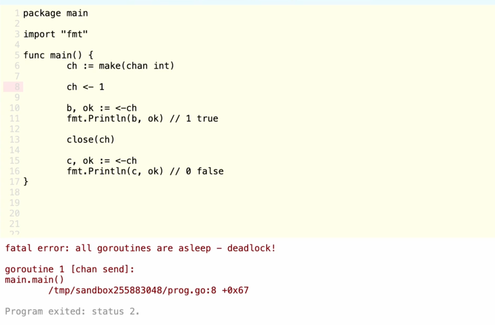
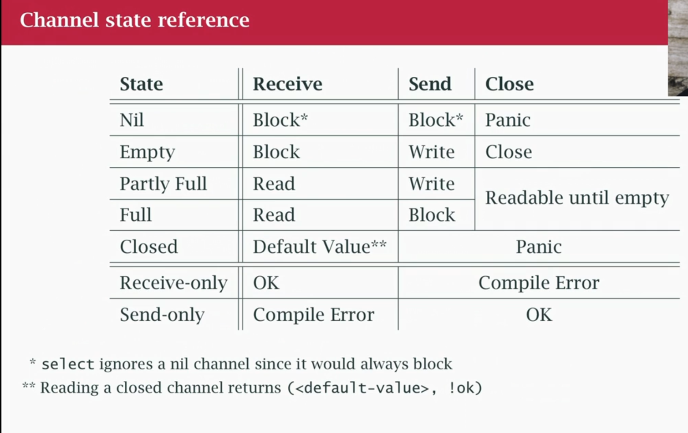
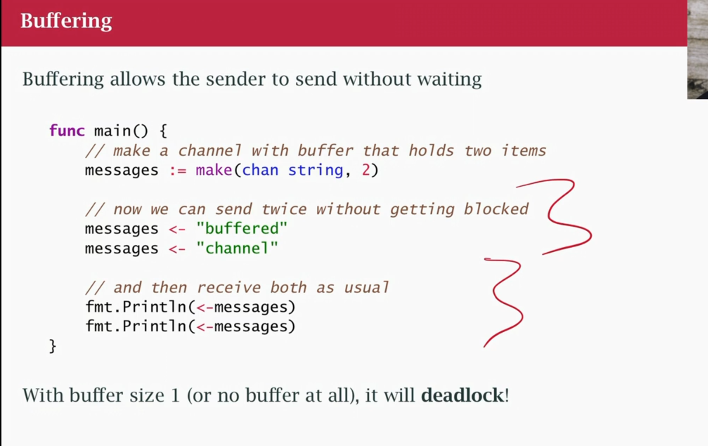
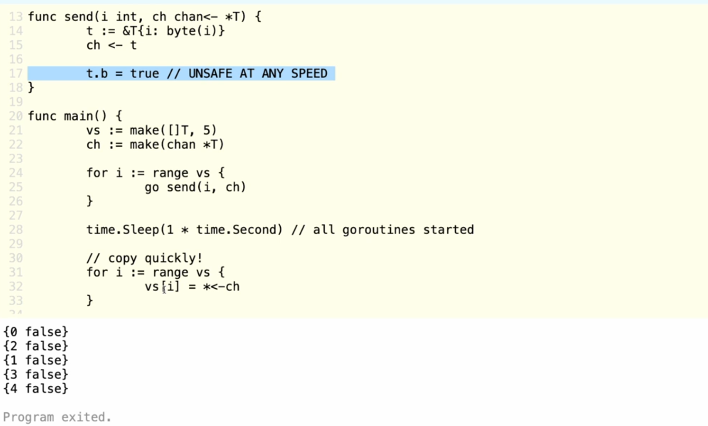

A primary way of passing data between go routines.

### Share memory by communicating
They are preferred over using [mutex](mutex.md) in
> Don't communicate by sharing memory. **Share memory by communicating** *

which essentially mean communication as a means to an end, which is sharing memory, not the other way around.
The former share a resource between many goroutines, while the latter pass ownership of the resource between goroutines, allowing each goroutine to work on it exclusively at a given time.

ChatGPT says:
> The former allows multiple processes to access a shared resource, requiring explicit synchronization when necessary. The latter communicates by transferring data or ownership between processes, using synchronization mechanisms built into the communication channel rather than relying on shared mutable state.

instead of 2 go routines communicating by sharing a resource (ie, counter variable, using mutex to lock the access), the goroutine send the result to the channel, while the other goroutine read the data via the channel. 
using channels make the role explicit, writing end or receiving end. it makes the code easier to reason. shared memory vs ownership


### Syntax
memorization of channel syntax is required first.

```golang
ch := make(chan int) // creating a channel

go func() {
	ch <- 10 // write to it
}

v := <-ch // read from it

// passing channels to functions
func writeToCh(ch chan<- int) 
func readFromCh(ch <-chan int)
```

> [!TIP]
> to differentiate between a read/write channel variable, a **writing** channel has arrow on the **right**. `chan<- type`


> [!NOTE] 
> It's conventional to have a goroutine that write to a channel, and a different goroutine reading from it.


> [!NOTE]
> you can read from a closed channel and the value will be defulat/zero. but if you get it with 2 values, the second value will be false.
> if you close it, you can't write to it, but you can still receive with buffered channels









> [!NOTE]
> Read finish before Write does in unbuffered channels.

### Examples

- Incrementing a counter can be done in safe manner by using channels by counter channel (chan int), a background go function (ch chan<- int) that write to it by incrementing in a for loop, while the handler for getting the counter value read from it (ch <-chan int). it is safe since the counter is incremented only after it is read, and when it read, it is after the counter is written as *a channel read will block execution until it is written, and a channel write will block until the channel is read*

- it is possible to use channels for summing numbers in a slice, by dividing the slice, and give the devision to 2 goroutines, which will write to a channel when it is done.
```go
import "fmt"

func sum(s []int, c chan int) {
	sum := 0
	for _, v := range s {
		sum += v
	}
	c <- sum // send sum to c
}

func main() {
	s := []int{7, 2, 8, -9, 4, 0}

	c := make(chan int)
	go sum(s[:len(s)/2], c)
	go sum(s[len(s)/2:], c)
	x, y := <-c, <-c // receive from c

	fmt.Println(x, y, x+y)
}
```


### closing
A sender can `close` a channel to indicate that no more values will be sent

`v, ok := <-ch`
ok return if the channel is close.


you can read a channel through a for loop, which ends when the channel is closed
```golang
for job := range jobsCh {
}
```

### signallation

Channels can also serve as a signal (mostly for cancellation), not just for trasferring values, and are commonly used with [select](select.md).

Examples:
- time.After(time.Second *5) // returns a channel, after the time is lost, write the current time to it(ch)
- time.NewTicker(time.Second*2).C // returns a channel and write to it every 2 second intervals

### Buffered Channels
```golang
ch := make(chan int, 2)
ch <- 3
ch <- 5

a := <-ch
b := <-ch
```
when a channel is buffered, you can write to the channel without being blocked (waiting until the channel is read in order to write a second time) until the buffer is full.

it is [Deadlock](Deadlock.md) to write to a channel more than the buffer length with no receiving end
